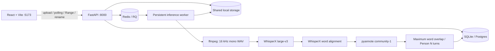

# Thread — Speaker-labeled audio transcription

A React 18 / FastAPI / RQ monorepo for uploading recordings, following word-level
transcripts, naming speakers, searching, and exporting TXT, SRT, or JSON. The default
mock engine produces **fake dialogue**, scaled to the recording duration, with three
speakers and 40 turns. It is for development, not transcription or accuracy claims.

## Quick start

Install Docker Desktop (Linux containers) or Docker Engine with Compose v2.

```sh
cp .env.example .env
docker compose up --build
```

PowerShell: `Copy-Item .env.example .env`. Open http://localhost:5173.
Upload audio or video, watch the stages, then click a timestamp or word to seek.
Click a speaker chip to rename it. Search matches have previous/next navigation.
Choose Export to download a file. Recent jobs and files persist in named volumes.
API documentation: http://localhost:8000/docs.

## Architecture



Inference always runs in the worker, outside API requests. Upload validation uses
ffprobe on the uploaded content, not its extension. Settings are read through
pydantic-settings. TranscriptionEngine and DiarizationEngine are independent
interfaces. Model instances are lazy and cached in a persistent RQ SimpleWorker
process. One job runs at a time per worker. Stage progress is coarse, not a time
estimate. SQLite is suitable for one development worker; use Postgres for scale.
SQLAlchemy's JSON column stores transcripts; migrations are needed for future
schema changes. LocalStorage is the extension point for S3 (not implemented).

## Real inference

1. Create a Hugging Face account and accept the model conditions at
   [pyannote/speaker-diarization-community-1](https://huggingface.co/pyannote/speaker-diarization-community-1).
2. Create a read token at https://huggingface.co/settings/tokens.
3. Set `ENGINE=whisperx` and `HF_TOKEN=...` in your local `.env`.
4. For GPU, install a compatible NVIDIA driver and NVIDIA Container Toolkit.
   On Windows, enable Docker Desktop's WSL2 GPU support.

```sh
docker compose -f docker-compose.yml -f docker-compose.gpu.yml up --build
```

The GPU worker uses CUDA 12.8, float16 and batch size 4 by default. CPU fallback:

```sh
docker compose -f docker-compose.yml -f docker-compose.cpu.yml up --build
```

The CPU worker installs the models and uses int8 / batch size 2; large-v3 on CPU
can be very slow. First inference downloads weights into a persistent model-cache
volume. The API image has no inference dependencies and receives no HF_TOKEN.
Only the worker receives that secret. Do not paste tokens into logs or commit `.env`.

The implemented real pipeline uses WhisperX large-v3, English forced alignment,
WhisperX's DiarizationPipeline with community-1, then assign_word_speakers with
maximum overlap and no nearest-speaker filling. Unassigned words become Unknown.
Raw speaker IDs are retained; Person N labels follow first appearance. Consecutive
words from the same speaker merge even across pauses. Missing alignment timestamps
are retained at the previous word end (or segment start); these timings are estimates.
Exact count and min/max options are mutually exclusive and limited to 1–8.

`TRANSCRIPTION_ENGINE` and `DIARIZATION_ENGINE` override `ENGINE` independently.
For example `TRANSCRIPTION_ENGINE=whisperx DIARIZATION_ENGINE=mock` exercises
real transcription with fake diarization. Parakeet (NeMo) and Nemotron-3-Diarization
(maximum 8 speakers) are explicit TODO stubs; selecting one fails with a clear job
error. `FREE_GPU_MEMORY=true` offloads weights between stages; default false favors
throughput. See [WhisperX upstream](https://github.com/m-bain/whisperX) for the
library and [diarization adapter](https://github.com/m-bain/whisperX/blob/main/whisperx/diarize.py)
for the community-1 integration. No hosted inference services are used.

## Local development and tests

Prerequisites: Python 3.11, Node 22+, ffmpeg and ffprobe on PATH, Redis.
Run commands from the repository root unless indicated otherwise.

```sh
python -m venv .venv
# Activate .venv (PowerShell: .\.venv\Scripts\Activate.ps1)
pip install -r backend/requirements-dev.txt
# Start just Redis if developing outside containers:
docker compose up -d redis
```

Compose Redis is internal by default. For local API/worker use, start Redis with
`docker run --rm -p 127.0.0.1:6379:6379 redis:7-alpine` instead.

```sh
cd backend
uvicorn app.main:app --reload
# Another terminal, also in backend:
python -m worker.main
# Frontend terminal:
cd frontend
npm ci
npm run dev
```

For local real engines install `backend/requirements-models.txt` in the same venv,
and set DEVICE / COMPUTE_TYPE appropriately. Native Windows real inference depends
on upstream model wheel support; the Linux containers are the preferred route.

```sh
# From backend, with the venv active:
python -m pytest tests -q
# From frontend:
npm test
npm run build
```

Tests generate a tiny mono WAV in memory. Backend tests cover content validation,
limits, mock orchestration, overlap assignment, Unknown handling, turn ordering,
exports, speaker renaming, ranges, and deletion. API tests replace only queue
submission and invoke the same worker function synchronously; a real Redis worker
is used for the Docker smoke test. Frontend tests cover rendering, seek clicks,
search highlights, and rename submission. No models or GPU are needed.

## API

| Method | Route | Purpose |
|---|---|---|
| POST | /api/jobs | Multipart file and optional num_speakers OR min/max_speakers |
| GET | /api/jobs | Most recent 30 jobs |
| GET | /api/jobs/{id} | Stage, progress, duration, creation time, error |
| GET | /api/jobs/{id}/transcript | Speakers, turns, words |
| PATCH | /api/jobs/{id}/speakers | Mapping of existing label or stable ID to new name |
| GET | /api/jobs/{id}/audio | Original bytes, single HTTP byte Range supported |
| GET | /api/jobs/{id}/audio?normalized=true | Browser-compatible normalized WAV |
| GET | /api/jobs/{id}/export?format=txt\|srt\|json | Download with current speaker names |
| DELETE | /api/jobs/{id} | Remove completed/failed job and audio files |

Processing stages: queued → preprocessing → transcribing → aligning → diarizing →
merging → completed, or failed. Pending transcript returns 409, failed transcript
returns 500 with the job error, bad content returns 400, oversize files 413, missing
jobs 404, invalid byte ranges 416, unavailable queue 503. Multiple byte ranges are
not supported. Delete is rejected while processing to avoid file/worker races.

## Accuracy evaluation

Put `clip.wav` and human reference `clip.json` (the API transcript shape) together
in a dataset folder. Include actual speaker turn boundaries, not just word text.
Install evaluation dependencies separately; they do not download model weights.

```sh
pip install -r backend/requirements-eval.txt
cd backend
python -m eval.evaluate ../dataset --csv ../results/mock.csv --save-predictions ../predictions/mock
# Set ENGINE=whisperx and HF_TOKEN in the environment, then:
python -m eval.evaluate ../dataset --csv ../results/whisperx.csv --save-predictions ../predictions/whisperx
# Score previously saved results without inference:
python -m eval.evaluate ../dataset --predictions ../predictions/whisperx --csv ../results/rescore.csv
```

Computes WER with jiwer, DER with pyannote.metrics (0.25 second collar, overlaps
included, recording-duration evaluation map), and cpWER with
[MeetEval](https://github.com/fgnt/meeteval). Text is lowercased, punctuation removed,
and whitespace normalized. cpWER optimally permutes speaker identities, so names
do not affect the score. Unknown is treated as a speaker. Output includes per-file
rows and unweighted macro averages, printed and written as decimal fractions in
CSV. Empty/missing references fail clearly. Engine overrides allow comparisons;
the two TODO engines must be implemented before evaluating them. No accuracy is
claimed from mock outputs. Overlapping reference turns are required to evaluate
overlap faithfully; the app's output gives only one speaker per word.

## Settings and limits

Every supported environment variable and its purpose is documented in
[.env.example](.env.example). Compose shares data between API and worker and stores
model downloads separately. To reset all local data, `docker compose down -v`
removes named volumes (destructive). Normal `docker compose down` preserves data.

Design choices: search is case-insensitive within words (multiword phrase search
is not implemented); speaker renaming uses stable IDs in the UI. Lists above 500
turns use variable-height virtualization. Audio auto-follow pauses for 5 seconds
on manual scroll. SRT cues are split at word boundaries to at most 7 seconds / 84
characters including label; exceptionally long words or intervals are subdivided.
The viewer plays normalized audio for reliable seeking across input formats while
the default audio endpoint retains the original file.

Known model limitations: overlapping speech, very short interjections, similar
voices, noisy recordings, proper names, and unalignable numerals can reduce quality.
English is forced; this app targets US English. Timings are alignment estimates,
not guaranteed exact ground truth. Silent recordings may produce no turns.

This is a local development application. Authentication, tenant isolation, TLS,
durable retry/recovery after worker crashes, retention policies, and production
deployment hardening are future work. SimpleWorker caches models but offers fewer
crash-isolation guarantees than a forked RQ worker. Do not expose this stack publicly
without adding those controls. Real GPU inference must be validated on your own
GPU and a representative reference dataset before relying on its output.
