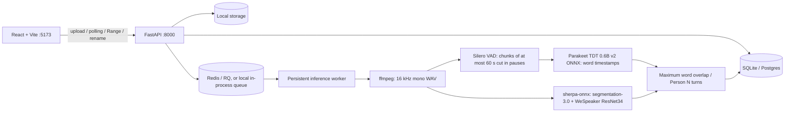

# Thread — Speaker-labeled audio transcription

For native development, Vite reads `API_PORT` / `API_PROXY_TARGET` from the root
`.env`. The default target is `http://127.0.0.1:<API_PORT>` (8000 if unset).
Use `http://127.0.0.1:5173` on this computer, or the network URL printed by Vite
from another device. `npm run dev` binds to all interfaces for LAN access; the
API proxy still connects locally over IPv4. Docker uses `http://api:8000`.
Restart Vite after changing `.env`. A failed proxy connection returns JSON 503
with setup guidance and logs the unavailable backend address in the Vite terminal.

A React 18 / FastAPI / RQ monorepo for uploading recordings (court sessions,
meetings, long multi-speaker conversations), following word-level transcripts,
naming speakers, searching, and exporting TXT, SRT, or JSON.

**CPU-first by default.** Transcription uses NVIDIA Parakeet TDT 0.6B v2 (English,
int8 ONNX) and diarization uses pyannote segmentation-3.0 plus an English
VoxCeleb WeSpeaker ResNet34 embedding model, all through
[sherpa-onnx](https://github.com/k2-fsa/sherpa-onnx). No GPU, PyTorch, or Hugging
Face token is needed; models (about 665 MB) download on first use. WhisperX and
pyannote Community-1 remain available as optional engines.

Every job and JSON transcript stores `transcription_engine` and `diarization_engine`
as actually executed by the worker; changing settings later does not change
completed job provenance. The `mock` engine produces **fake dialogue** for UI
development, and any mock stage shows a persistent **DEMO DATA — not a real
transcription of your audio** banner. Jobs created before provenance tracking show
`unknown` and a warning. Each job also records `stage_timings` (seconds for
preprocess, transcribe including alignment, diarize, merge, and total) so CPU speed
can be measured; the worker logs the real-time factor when a job completes.

`APP_ENV` accepts `development` (default) or `production`. Production workers refuse
to start if any engine is `mock`. Startup logs list engines, model names, device,
and only the presence of HF_TOKEN. The header polls `/api/health` every 10 seconds
for the configured engines, queue state and, in local mode, engine readiness.
Repository `.env` settings are read when local commands run from `backend/` too.

## Quick start

Install Docker Desktop (Linux containers) or Docker Engine with Compose v2.

```sh
cp .env.example .env
docker compose up --build
```

PowerShell: `Copy-Item .env.example .env`. Open http://localhost:5173.
Upload audio or video, watch the stages, then click a timestamp or word to seek.
Click a speaker chip to rename it. Search matches have previous/next navigation.
Choose Export to download a file. Recent jobs and files persist in named volumes.
API documentation: http://localhost:8000/docs.
If port 8000 is occupied, set `API_PORT=8001` in `.env`; API docs then use 8001.
The frontend continues to use the internal API address automatically.
Similarly, `FRONTEND_PORT=5174` changes the frontend host port if 5173 is occupied.

## Architecture



Inference runs in the worker (or the API's background thread with
`QUEUE_BACKEND=local`), never inside an API request. Upload validation uses ffprobe
on the uploaded content, not its extension. TranscriptionEngine and DiarizationEngine
are independent interfaces; model instances are lazy and cached per engine name in
the persistent worker. One job runs at a time per worker. Stage progress is coarse,
not a time estimate. SQLite suits one worker; use Postgres for scale.
LocalStorage is the extension point for S3 (not implemented).

## Engines

| Setting | Values (default first) | Needs |
|---|---|---|
| `TRANSCRIPTION_ENGINE` | `parakeet_onnx`, `whisperx`, `mock` | `requirements-cpu.txt`; WhisperX: `requirements-models.txt` |
| `DIARIZATION_ENGINE` | `sherpa_onnx`, `pyannote`, `mock` | `requirements-cpu.txt`; pyannote: `requirements-pyannote.txt` + `HF_TOKEN` |

`ENGINE` is an optional legacy preset (`cpu`, `whisperx` = whisperx + pyannote,
`mock`); the two settings above always win over it.

**Parakeet (`parakeet_onnx`).** Silero VAD finds speech; the recording is split into
chunks of at most `MAX_CHUNK_SEC` (60) seconds, cut in the middle of pauses so no
word is split and nothing at a VAD edge is lost. Inside continuous speech with no
pause in the window, the cut goes at the quietest 20 ms frame of the window's second
half. Each chunk is decoded and its timestamps are offset back onto the recording
timeline. Word timestamps come from the model's token timestamps and TDT durations
(sub-word tokens merged into words; punctuation does not stretch a word), so there
is no separate alignment step. Word scores are mean token probabilities.

**sherpa-onnx diarization (`sherpa_onnx`).** Speaker options map onto its clustering:
an exact `num_speakers` (or equal min and max) fixes the speaker count; otherwise
clustering uses `DIARIZATION_THRESHOLD` (default 0.5; larger merges more voices), and
if the number found falls outside min/max it is re-run once with the count set to
the nearest bound (for example 9 found with max 6 becomes exactly 6). The re-run
repeats segmentation and embedding, roughly doubling diarization time.

**pyannote Community-1 (`pyannote`, optional).** Runs on CPU with PyTorch; install
`requirements-pyannote.txt`, accept the conditions at
[pyannote/speaker-diarization-community-1](https://huggingface.co/pyannote/speaker-diarization-community-1),
and set `HF_TOKEN`. PyTorch is never imported unless this engine is selected. On
Windows, Smart App Control / Application Control can block PyTorch DLLs; if so use
the ONNX engines or the Docker worker.

**WhisperX (`whisperx`, optional).** WhisperX `WHISPER_MODEL` (large-v3) with English
forced alignment; mainly for GPU hosts.

All diarization engines feed the same merge: each word takes the speaker with the
largest overlap, words overlapping no speaker become Unknown, raw speaker IDs are
kept, Person N labels follow first appearance, and consecutive words from one speaker
merge into a turn. Exact count and min/max options are mutually exclusive and limited
to 1–`MAX_SPEAKERS` (20).

`NUM_THREADS` defaults to the number of physical cores. On hybrid Intel CPUs
(performance + efficiency cores) setting it to the performance-core count is often
faster; laptops on battery or a power-saving plan run much slower. Models download
on first use into `MODELS_DIR` with progress in the logs; an interrupted download is
never mistaken for a complete one.

### Docker

```sh
docker compose up --build                                                           # CPU engines
docker compose -f docker-compose.yml -f docker-compose.whisperx-cpu.yml up --build  # WhisperX + pyannote on CPU
docker compose -f docker-compose.yml -f docker-compose.gpu.yml up --build           # WhisperX + pyannote on NVIDIA GPU
```

The default worker image (`cpu` target) has no PyTorch; a `pyannote` target adds it.
Model downloads persist in the `model-cache` volume. The API image has no inference
dependencies and never receives HF_TOKEN. The GPU worker uses CUDA 12.8, float16 and
batch size 4 and needs the NVIDIA Container Toolkit (WSL2 GPU support on Windows).
Do not paste tokens into logs or commit `.env`.

The opt-in real-engine test runs actual WhisperX/pyannote:

```powershell
# From backend/ with the venv active; HF_TOKEN must be configured.
$env:RUN_REAL_ENGINE_TEST="1"
$env:REAL_ENGINE_AUDIO="C:\recordings\english-speech.wav"
python -m pytest tests/test_real_engine.py -q
```

## Local development and tests

Prerequisites: Python 3.11, Node 22+, ffmpeg and ffprobe on PATH (Redis only for
the Redis queue). Run commands from the repository root unless indicated otherwise.

```sh
python -m venv .venv
# Activate .venv (PowerShell: .\.venv\Scripts\Activate.ps1)
pip install -r backend/requirements-cpu.txt   # default inference engines
pip install -r backend/requirements-dev.txt   # + tests
```

Data lives outside OneDrive and other synced folders by default, because sync locks
and partial syncs corrupt SQLite and interrupt large uploads: `%LOCALAPPDATA%\transcriber`
on Windows (`$XDG_DATA_HOME/transcriber` or `~/.local/share/transcriber` elsewhere)
holds `jobs.db`, `files/` and `models/`. Override with `DATABASE_URL`, `STORAGE_DIR`
and `MODELS_DIR`.

**Native Windows without Docker or Redis:** set `QUEUE_BACKEND=local` in the root
`.env` and run `powershell -ExecutionPolicy Bypass -File scripts\start-local.ps1`.
Jobs run one at a time on a background thread inside the API (models stay cached),
unfinished jobs are resumed when the API restarts, and the script starts uvicorn on
`API_PORT` and points the Vite proxy at that same port. In local mode, `/api/health`
reports `engine_issue` (for example sherpa-onnx or pyannote not installed, or
`HF_TOKEN` missing), and uploads are refused with that reason. A Redis worker whose
engines cannot load refuses to start.

Choose one topology and keep its API, database, files, Redis, and worker together.
The normal and recommended mode is full Compose: `docker compose up --build` and
open its configured frontend port. For a native API and worker, start a dedicated
Redis on a free loopback port, then set the same URL and queue name for both:

```sh
docker run --rm -p 127.0.0.1:6380:6379 redis:7-alpine
# root .env
# REDIS_URL=redis://127.0.0.1:6380/0
# RQ_QUEUE_NAME=audio-transcriber-local
```

Do not point a native API at Compose's internal `redis` hostname, and do not share
another project's default RQ queue. `/api/health` reports `ready`, `no_worker`, or
`unavailable`; the UI disables upload until a worker listens on the configured queue.
The Vite server uses strict port binding: if 5173 is occupied it exits with a clear
error instead of silently moving onto the Compose frontend port. Stop the existing
frontend or intentionally pass a free port; do not run native and Compose frontends
on the same host port.

```sh
cd backend
uvicorn app.main:app --reload
# Another terminal, also in backend:
python -m worker.main
# Frontend terminal:
cd frontend
npm ci
npm run dev
```

The CPU engines run natively on Windows. For WhisperX install
`backend/requirements-models.txt` and set DEVICE / COMPUTE_TYPE; for pyannote install
`backend/requirements-pyannote.txt`.

```sh
# From backend, with the venv active:
python -m pytest tests -q
# From frontend:
npm test
npm run build
# With mock Compose running, from root:
python scripts/smoke.py
```

Tests generate a tiny mono WAV in memory and include a generated WAV fixture.
Backend tests cover content validation, limits, mock orchestration, chunk planning
and timestamp offsetting, sub-word merging, speaker-count mapping, overlap
assignment, Unknown handling, stage timings, the CHAT converter, cpWER, exports,
speaker renaming, ranges, and deletion. Real-inference tests (silence, word
timestamps on speech, chunk-edge consistency, exact speaker counts, a full job) skip
automatically when the models are absent; with models present they take several
minutes on a laptop CPU, so set SKIP_MODEL_TESTS=1 for quick runs. Speech checks use
the Santa Barbara corpus SBC019 recording and CHAT file via SBC019_WAV / SBC019_CHA. API tests replace only queue
submission and invoke the same worker function synchronously; a real Redis worker
is used for the Docker smoke test. Frontend tests cover rendering, seek clicks,
search highlights, and rename submission. No models or GPU are needed.

## API

| Method | Route | Purpose |
|---|---|---|
| POST | /api/jobs | Multipart file and optional num_speakers OR min/max_speakers |
| GET | /api/jobs | Most recent 30 jobs |
| GET | /api/jobs/{id} | Stage, progress, duration, creation time, error |
| GET | /api/jobs/{id}/transcript | Speakers, turns, words |
| PATCH | /api/jobs/{id}/speakers | Mapping of existing label or stable ID to new name |
| GET | /api/jobs/{id}/audio | Original bytes, single HTTP byte Range supported |
| GET | /api/jobs/{id}/audio?normalized=true | Browser-compatible normalized WAV |
| GET | /api/jobs/{id}/export?format=txt\|srt\|json | Download with current speaker names |
| DELETE | /api/jobs/{id} | Remove completed/failed job and audio files |

Processing stages: queued → preprocessing → transcribing → aligning → diarizing →
merging → completed, or failed. Pending transcript returns 409, failed transcript
returns 500 with the job error, bad content returns 400, oversize files 413, missing
jobs 404, invalid byte ranges 416, unavailable queue 503. Multiple byte ranges are
not supported. Delete is rejected while processing to avoid file/worker races.

## Accuracy evaluation

Evaluate one recording, or a folder of recordings each with a reference named
`<stem>.json` (the API transcript shape) or `<stem>.cha` (CHAT). Several engine
combinations run side by side:

```sh
pip install -r backend/requirements-eval.txt
cd backend
python -m eval.evaluate --audio SBC0019.wav --reference SBC019.cha \
    --engines parakeet_onnx+sherpa_onnx parakeet_onnx+pyannote \
    --csv ../results/sbc019.csv --save-predictions ../predictions
python -m eval.evaluate ../dataset --engines parakeet_onnx+sherpa_onnx --csv ../results/dataset.csv
# Score saved predictions (one folder per combination) without inference:
python -m eval.evaluate ../dataset --predictions ../predictions --engines parakeet_onnx+sherpa_onnx
```

Each row shows WER (jiwer), DER (pyannote.metrics, 0.25 s collar, overlap
included, scored over the whole recording), cpWER, audio length, processing time,
and the speed factor (audio length / processing time; above 1 is faster than real
time). Combinations sharing a transcription engine reuse one transcription, but
each row's processing time includes it. A combination that cannot run (for example
pyannote without PyTorch or HF_TOKEN) is listed as skipped with the reason.
`--oracle-speakers` passes the reference speaker count. Text is lowercased,
punctuation removed and whitespace normalized; digits are not spelled out, so
numerals and contractions (gonna / going to) count as errors against spoken-form
references. cpWER permutes speaker identities optimally, so names do not matter; it
uses [MeetEval](https://github.com/fgnt/meeteval) when installed and an equivalent
built-in implementation otherwise (MeetEval needs a C++ build on Windows).

**CHAT references.** `python -m eval.chat SBC019.cha SBC019.json` converts a CHAT
transcript (as in the Santa Barbara corpus); `.cha` files can also be passed
directly. Every timing bullet becomes a reference turn; ENV and X tiers, headers and
dependent tiers are ignored; events (`&=laugh`), scoped markers (`&{l=X`), fragments,
cut-off words (`r-`), overlap brackets (`⌈ ⌉ ⌊ ⌋`), pauses, terminators, comments,
codes, lengthening colons and glottal-stop symbols are stripped, fillers (`&-uh`)
keep the spoken word and replacements (`word [: target]`) use the target. Word times
within a turn are spread evenly, so only turn boundaries matter for DER. Corpus
files are not included in this repository.

No accuracy is claimed from mock outputs. The app's output gives one speaker per
word, so overlapping reference speech always counts against DER.

## Settings and limits

Every supported environment variable and its purpose is documented in
[.env.example](.env.example). Compose shares data between API and worker and stores
model downloads separately. To reset all local data, `docker compose down -v`
removes named volumes (destructive). Normal `docker compose down` preserves data.

Design choices: search is case-insensitive within words (multiword phrase search
is not implemented); speaker renaming uses stable IDs in the UI. Lists above 500
turns use variable-height virtualization. Audio auto-follow pauses for 5 seconds
on manual scroll. SRT cues are split at word boundaries to at most 7 seconds / 84
characters including label; exceptionally long words or intervals are subdivided.
The viewer plays normalized audio for reliable seeking across input formats while
the default audio endpoint retains the original file.

Known model limitations: overlapping speech, very short interjections, similar
voices, noisy recordings, and proper names can reduce quality. Parakeet TDT 0.6B v2
is English-only. Timestamps are model estimates, not exact ground truth. Silent
recordings may produce no turns.

This is a local development application. Authentication, tenant isolation, TLS,
durable retry/recovery after worker crashes, retention policies, and production
deployment hardening are future work. SimpleWorker caches models but offers fewer
crash-isolation guarantees than a forked RQ worker. Do not expose this stack publicly
without adding those controls. Validate any engine on representative recordings
from your own setting (for example court audio) with the evaluation CLI before
relying on its output.
